# Pi‑Agent 实践课1：Pi Agent安装与使用

## 任务一 本地安装并启动Pi

**操作**：按照官方安装命令在PowerShell执行Pi客户端安装；安装完成后新建`pi‑test`项目文件夹，进入该目录，执行`pi`命令启动Pi客户端。

**结果**：Pi客户端成功启动，终端显示版本信息与当前工作目录，出现`No models available`提示，代表客户端本身安装运行正常，等待配置模型密钥。

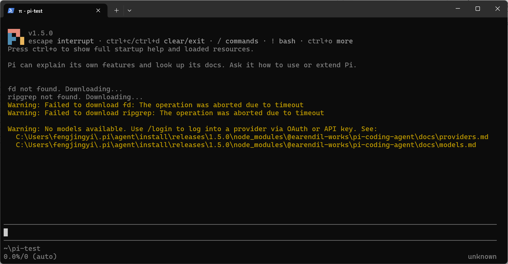

## 任务二 配置模型并完成一次会话

**操作**：获取deepseek API‑Key，在Pi内输入`/login`，选择API密钥方式登录，选定模型提供商；配置完成后发送简单测试消息`hello?`。

**结果**：登录配置成功，模型接收到提示词并正常返回回复，基础对话交互功能可用。截图包含输入提示词、模型回复、当前使用模型信息，未泄露密钥。

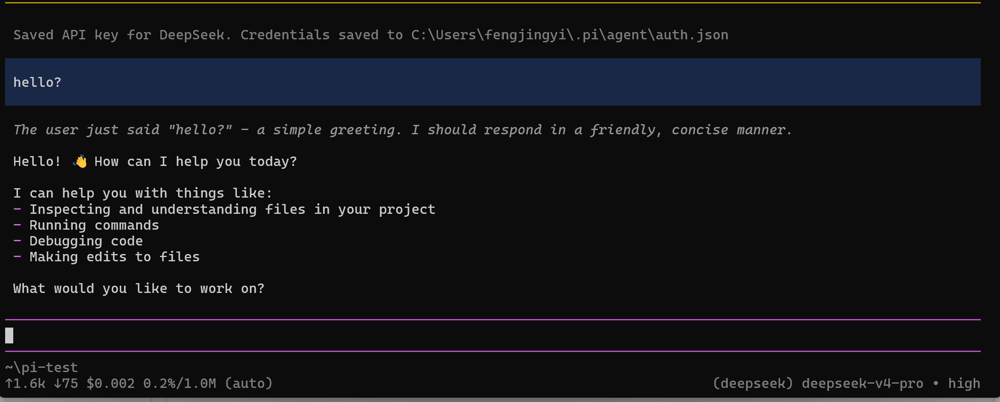

## 任务三 切换模型与模型思考级别

**操作**：使用`/model`命令打开模型选择器，初始模型选用deepseek-v4-pro，切换为deepseek-flash，并发送简单测试信息`你好`。再使用`/thinking`命令调整思考级别，从`high`切换至`low`。

**结果**：模型切换成功，两个模型均可正常响应对话并且思考级别切换生效。
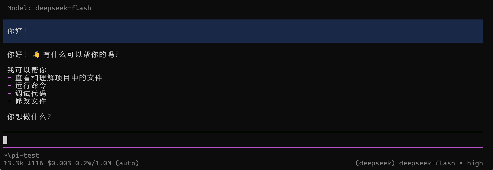

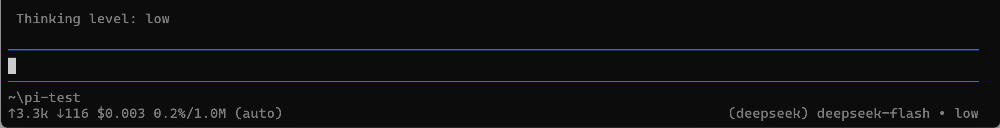

说明：
- 任务二图片中可见选择的是deepseek-v4-pro + high,任务三中第一张图片换为deepseek-flash + high,由此可见模型切换成功，且能正常会话；第二张图可见思考级别由high变为low，思考级别切换成功。
- 任务复杂度会影响选择：简单问答类任务，选用low思考级别，token消耗更少、响应更快；复杂推理、代码分析类任务，可选用medium或high，提升推理深度，但high级别不会保证答案一定更好，会增加等待时长与API额度消耗，部分模型不支持思考级别调节。

## 任务四 引用代码文件并粘贴小图片测试

### 4.1 使用@引用代码文件

**操作**：在项目目录新建`hello.py`，写入加法测试代码；启动Pi，输入`@`选中`hello.py`文件，发送提示词：`请解释 @hello.py 的功能，说明运行后输出什么。只解释，不修改文件。`

**结果**：成功引用目标代码文件，模型解析add函数逻辑，给出程序运行输出结果5，文件引用功能验证完成。

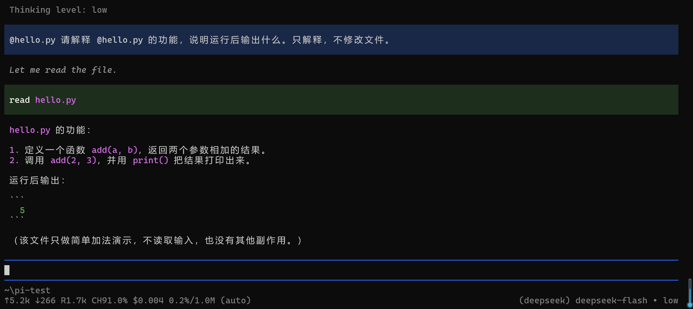

### 4.2 粘贴小图片完成图像识别测试

**操作**：使用画图工具绘制测试图片（蓝色方块内部写数字7），保存为本地图片文件；在Pi会话中通过文件引用方式加载图片，发送指令：`请描述图片中的颜色、形状和数字。`

**结果**：图片文件成功加载，模型正确识别图片中的蓝色方块、数字7，验证了Pi的多模态图像理解功能。

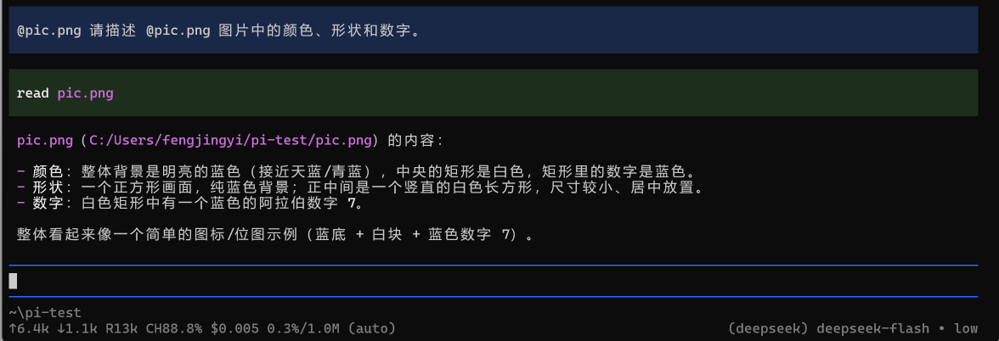

> 备注：本次测试发现终端剪贴板直接粘贴图片的方式存在兼容性问题，改用文件上传方式完成图像输入测试。

## 任务五 安装并使用一个插件

**操作**：访问`pi.dev/packages`，选择`pi-web-access`插件；进入`pi-test`项目目录，在PowerShell中执行命令`pi install npm:pi-web-access -l --approve`进行项目本地安装；安装完成后完全退出Pi，重新在当前目录执行`pi`启动; 查看启动日志`[Extensions]`，确认`pi-web-access:dist`加载成功; pi输入/websearch调用插件网页搜索功能，输入检索内容进行网页查询，等待网页检索面板返回结果。

**结果**：
- 插件安装完成，重启Pi后启动日志扩展列表中出现`pi-web-access:dist`，代表插件加载成功；
- 调用网页搜索功能后弹出web检索页面，成功获取网页检索结果。
- 插件用途：提供网页访问与联网搜索能力，支持在Pi会话中检索互联网信息并生成摘要。
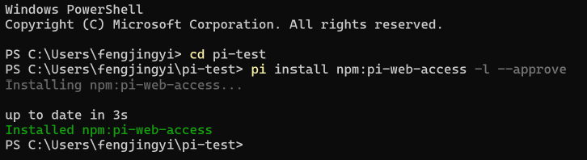
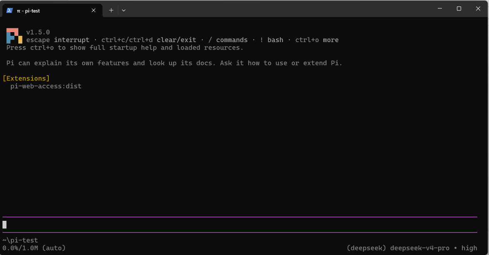
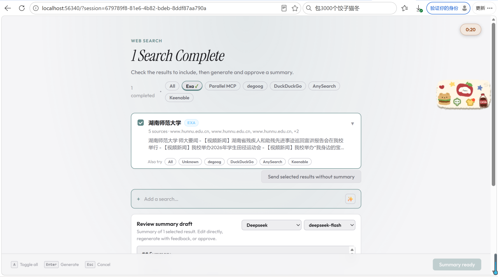

## 任务六 让AI安装PPT Skill（选做）

### 6.1 部署pptx skill

**操作**：向Agent发送提示词，让AI从`anthropics/skills`仓库下载`skills/pptx`。

**结果**：目标目录生成，完整包含`SKILL.md`、`LICENSE.txt`以及scripts脚本文件夹，全部源文件部署到位。

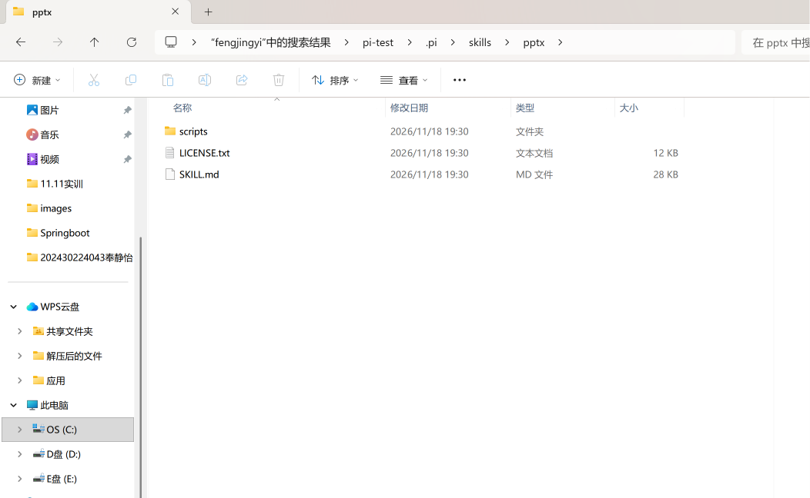

### 6.2 Pi重启发现skill与调用验证

**操作**：完全退出Pi会话，回到项目目录重新执行`pi`启动，观察启动输出的`[Skills]`列表；执行调用指令 `/skill:pptx 请说明这个 Skill 的名称、用途和所在目录，`。

**结果**：Pi启动扫描成功发现pptx skill；调用指令执行完成，返回skill名称、功能用途、本机完整存放路径。

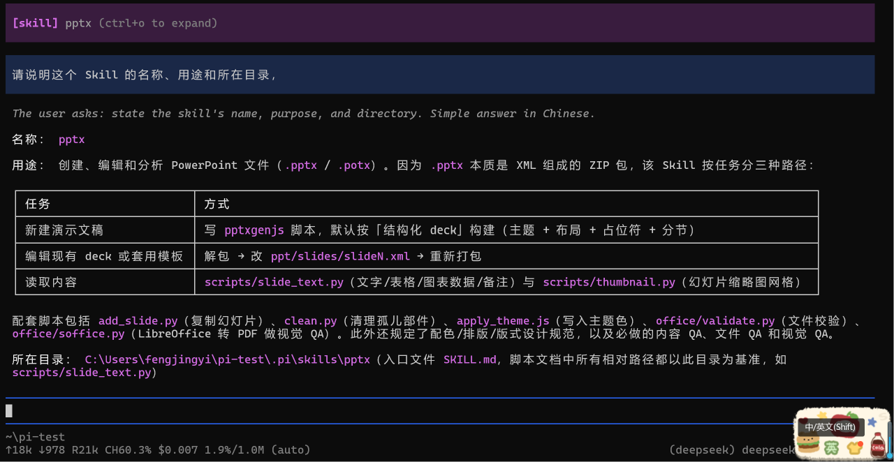

> 备注：本次未做PPT生成测试。
